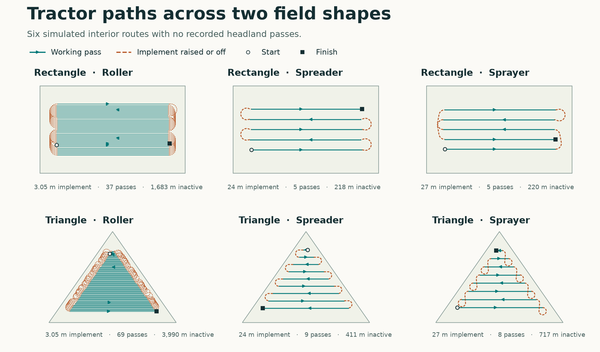
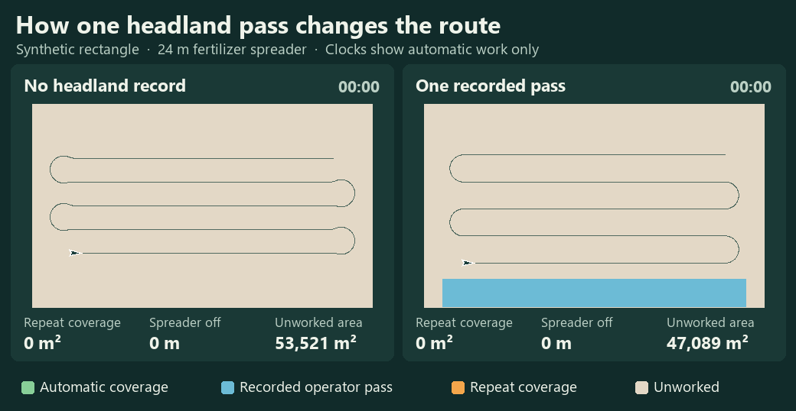

# Tractor Guidance Simulator

When I reach the end of a row, I switch off the sprayer, turn the tractor and start spraying again on the next pass. The tire tracks show where I drove. They can't tell me where I applied the spray. I built **Mark 42** to record both the tractor's path and the strip its implement actually worked.

**Salih Çağdaş** · Route planning, a tablet cab display and sensor testing on Raspberry Pi

[Route gallery](case-studies/route-gallery.md) · [Row-order comparison](case-studies/route-order.md) · [Validation results](case-studies/validation-results.md) · [Source availability](#source-availability)

The sprayer completed eight passes in **26 minutes 16 seconds** of simulated work. Watch the turn at the end of a green strip. The tractor keeps moving while the sprayed area stays the same. Over the full route, it traveled **716.69 m with the sprayer off**, or 37.3% of its 1.92 km path. At the finish the cab still showed 3.003 hectares with no recorded coverage along the edges. [Final cab readout](images/job-summary.png)

## Where the tractor actually goes

The rectangle makes the difference easy to see. The spreader works the five rows in sequence. The sprayer visits rows **1 → 3 → 5 → 4 → 2**. Both finish the interior. On the triangle, the sprayer takes one fewer pass than the spreader but travels 305 m farther with the implement off. [Pass counts, distance and time for all six routes](case-studies/route-gallery.md)

I also put Mark 42 and five Courseplay patterns on the **same 37 roller lanes**. All six covered the interior. Mark 42 spent **5 minutes 12 seconds less** on the modeled job than the next-fastest sequence, saving **312 m** with the roller inactive. [Compare all six lane orders](case-studies/route-order.md)

## What the operator can do

1. **Choose an implement and a heading.** The simulator can plan passes and turns for a 3.05 m roller, a 24 m fertilizer spreader or a 27 m sprayer on the same field. Changing the working width or direction produces a new route. The roller lifts for a turn and lowers on the next pass.
2. **Record the operator's headland passes.** The operator can drive the edges and record passes with the implement engaged. The planner then uses that record to route the remaining interior work. The map shows which strips the operator covered and where application overlapped.
3. **Pause and pick up where the job left off.** The Raspberry Pi saves the worked area, the current pass and the position along it. After a restart, the operator can resume the same route. [View the tablet cab display](images/cab-display.png)

The cab screenshots show the running simulation with the on-screen labels translated into English for this case study.

## What one recorded headland pass changes

The blue strip on the right is the operator's earlier pass. With that work recorded, the planner placed the next five automatic passes differently. The repeated area fell from **2,742 m² to 91.2 m²**. The right-hand clock stops **57 seconds earlier**. Both clocks cover the automatic portion only. [Worked area, remaining ground and overlap for both runs](case-studies/field-coverage.md)

## What the tests showed

| Experiment | Recorded result |
| --- | --- |
| A physical Raspberry Pi processed 312 simulated sensor runs | When GPS position and speed were wrong together, GPS alone missed the fault in 24/24 trials. Comparing wheel speed, steering angle and inertial measurements caught it in 24/24, after **1.82–4.70 s**. A fixed error present at startup remained undetected. [Position integrity](case-studies/position-integrity.md) |
| A tractor model drove 12 physics scenarios | **8 finished and 4 handed control back**. The handovers occurred in mud, on a slope, on mixed soil and with unequal wheel grip. Those conditions still need field measurements. [Physics and software test results](case-studies/validation-results.md) |
| The Pi rebooted with two jobs saved | One job was paused and the other was running. Both came back paused with their original route, position, elapsed time and worked area. Both finished after the operator resumed them. [Restart experiment](case-studies/position-integrity.md#where-does-a-job-resume-after-a-pi-restart) |
| Software regression tests | The November 19 release passed **515 Python simulation checks** and **109 Node.js tests**. In a separate fault experiment, loss of motor feedback cut modeled steering permission after 80 ms. Physical motor response still requires a bench test. [Test groups and fault timings](case-studies/validation-results.md) |

## Project status

The cab software runs on a Raspberry Pi. A tablet connects over the local network to display the route and job record. The planned tractor installation adds a portable base station to send positioning corrections to the receiver on the tractor. A separate controller will decide when to enable the steering motor. Reopening a saved job and enabling the motor are separate operator actions in this design.

| Phase | Status |
| --- | --- |
| **A · Software and simulation** | The route planner, cab display and job records are working. I tested implement coverage on synthetic fields and ran restart and simulated sensor-fault tests on a physical Raspberry Pi. |
| **B · Bench testing and installation** | The next step is to test the base station, receiver, wheel sensors and steering motor together, including power loss and manual steering takeover. |
| **C · Field trials with an operator** | Row tracking, missed and repeated coverage, and steering takeover still need to be measured on the tractor. |

## Source availability

I maintain this public repository solely as a portfolio of the project. It contains selected simulation replays, route comparisons and test results. All original source code developed for Mark 42 is proprietary to Salih Çağdaş and is kept in a private repository. Third-party software retains its own licenses and copyright notices.

© 2026 Salih Çağdaş. All rights reserved for the original project materials.
