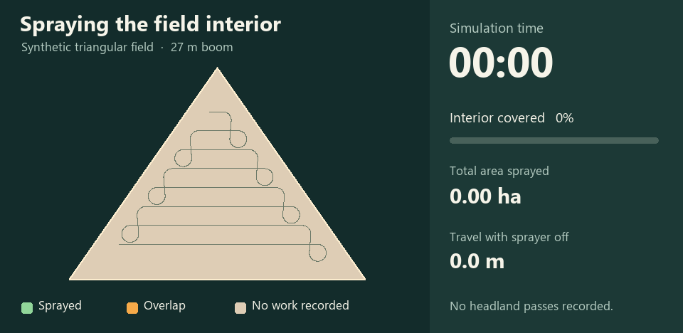
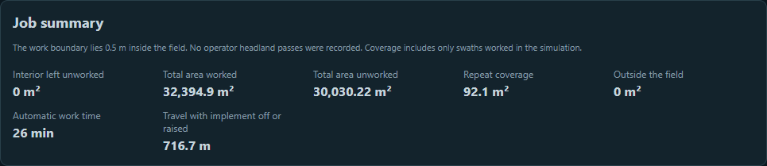

# Tractor Guidance Simulator

When I reach the end of a row, I switch off the sprayer, turn the tractor and start spraying again on the next pass. The tire tracks show where I drove. They can't tell me where I applied the spray. I built **Mark 42** to record both the tractor's path and the strip its implement actually worked.

**Salih Çağdaş** · Route planning, a tablet cab display and sensor testing on Raspberry Pi

The arrow marks the tractor and each green strip shows a spray pass. During a turn, the distance traveled with the sprayer off increases while the sprayed area stays the same. The interior passes took **26 minutes 16 seconds** of simulated work. At the finish, the display still showed **3.003 hectares** with no recorded coverage because the example included no operator passes around the boundary.

## What the operator can do

1. **Choose an implement and a heading.** The simulator can plan passes and turns for a 3.05 m roller, a 24 m fertilizer spreader or a 27 m sprayer on the same field. Changing the working width or direction produces a new route. The roller lifts for a turn and lowers on the next pass.
2. **Record the operator's headland passes.** The operator can drive the edges and record passes with the implement engaged. The planner then uses that record to route the remaining interior work. The map shows which strips the operator covered and where application overlapped.
3. **Pause and pick up where the job left off.** The Raspberry Pi saves the worked area, the current pass and the position along it. After a restart, the operator can resume the same route. [View the tablet cab display](images/cab-display.png)

The cab screenshots show the running simulation with the on-screen labels translated into English for this case study.

## What changed in testing?

| Question | Result |
| --- | --- |
| Does recording the operator's edge pass help? | On a synthetic rectangle, recording one pass with the 24 m spreader reduced the area fertilized more than once from **2,742 m² to 91.2 m²**. Automatic travel with the spreader off fell from **217.85 m to 162.80 m**. The operator's own time on that pass is separate. [Six routes and an edge-pass comparison](case-studies/field-coverage.md) |
| What if GPS reports the wrong position and speed together? | A GPS-only check missed the fault **in all 24 runs**. Comparing the reported motion with wheel speed, steering angle and an inertial sensor triggered a steering cutoff **in all 24 runs**. A constant position error present from startup still went undetected. [Sensor faults and restart tests on the Pi](case-studies/position-integrity.md) |

## Project status

The cab software runs on a Raspberry Pi. A tablet connects over the local network to display the route and job record. The planned tractor installation adds a portable base station to send positioning corrections to the receiver on the tractor. A separate controller will decide when to enable the steering motor. Reopening a saved job and enabling the motor are separate operator actions in this design.

| Phase | Status |
| --- | --- |
| **A · Software and simulation** | The route planner, cab display and job records are working. I tested implement coverage on synthetic fields and ran restart and simulated sensor-fault tests on a physical Raspberry Pi. |
| **B · Bench testing and installation** | The next step is to test the base station, receiver, wheel sensors and steering motor together, including power loss and manual steering takeover. |
| **C · Field trials with an operator** | Row tracking, missed and repeated coverage, and steering takeover still need to be measured on the tractor. |

© 2026 Salih Çağdaş. All rights reserved for the text and images.
