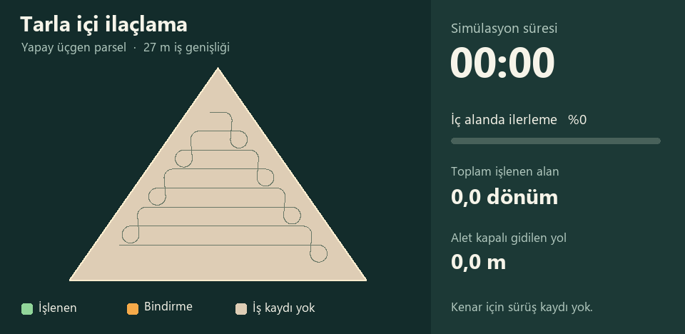
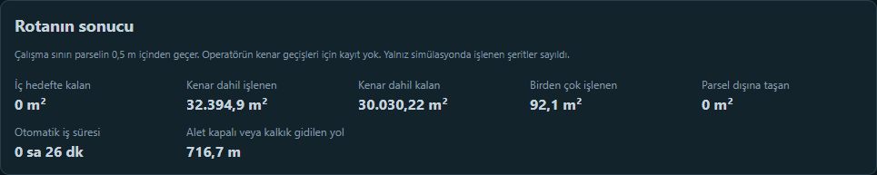

# Traktör Dümenleme Simülasyonu

Tarlada köşeye gelince ilacı kapatır, dönüşü alır ve yeni sırada tekrar açarım. Sonradan yalnız traktörün geçtiği çizgiye bakarsam nerede ilaç attığımı, nerede boş döndüğümü ayırt edemem. Bu yüzden **Mark 42**'yi geliştirirken traktörün yolunu ve arkasındaki aletin işlediği alanı ayrı kaydeden bir kabin tasarladım.

**Salih Çağdaş** · Rota planlama, tablet için kabin arayüzü ve Raspberry Pi üzerinde sensör deneyleri

Yukarıdaki üçgen, deneme için çizilmiş bir tarla. Ok traktörü, yeşil şeritler ilaçlanan yeri gösteriyor. Dönüşte **alet kapalı gidilen yol** artarken yeni bir yeşil şerit oluşmuyor. 26 dakika 16 saniyenin sonunda içteki hatlar bitiyor. Kenarlarda sürücünün yaptığı işe ait kayıt bulunmadığından kabin orada hâlâ 30,03 dönüm açık gösteriyor.

## Sürücü kabinde ne yapıyor?

1. **Aleti seçiyor.** Aynı tarla için 3,05 m silindir, 24 m gübre makinesi veya 27 m ilaç makinesi seçilebiliyor. Aletin eni ve çalışma yönü değişince kabin yeni hatları ve dönüşleri hesaplıyor. Silindir dönüşte kalkıyor, yeni hatta iniyor.
2. **Kenarları kendisi işleyebiliyor.** Sürücünün alet açıkken yaptığı geçişler kaydedilince sistem kalan iç alanı buna göre planlıyor. Haritada sürücü de kendi işini ve tekrar geçilen yerleri görebiliyor.
3. **Mola verip devam ediyor.** Raspberry Pi işlenen alanı, son hattı ve o hattaki konumu saklıyor. Kabin yeniden açıldığında sürücü kalan işi aynı rotadan sürdürebiliyor. [Tablet boyutunda kabin ekranı](gorseller/kabin.png)

## İki deneyde ne öğrendim?

| Soru | Deneyde gördüğüm |
| --- | --- |
| Kenarı sürücünün işlediğini bilmek ne kazandırıyor? | Yapay dikdörtgende 24 m gübre makinesiyle tekrar gübrelenen yer **2.742 m²’den 91,2 m²’ye** düştü. Otomatik bölümde boş gidiş de **217,85 m’den 162,80 m’ye** indi. Sürücünün kendi geçiş süresi ayrıca hesaba katılmalı. [Altı rota, kapsama haritaları ve kenar deneyi](incelemeler/tarla-deneyi.md) |
| GPS hem konumu hem hızı yanlış gösterirse ne olur? | Yalnız GPS'i kontrol ettiğimde hata **24 denemenin hiçbirinde** fark edilmedi. Bildirilen hareketi teker hızı, direksiyon açısı ve hareket sensörüyle karşılaştırınca **24 denemenin hepsinde** dümen izni kesildi. Başlangıçtan beri sabit kalan konum kayması yine algılanamadı. [Pi üzerinde hata ve yeniden başlatma deneyleri](incelemeler/konum-guvenligi.md) |

## Sistem bugün hangi aşamada?

Kabin yazılımı Raspberry Pi'de çalışıyor. Tablet yerel ağdan bu bilgisayara bağlanıp rotayı ve iş kaydını gösteriyor. Traktörde kullanmak için tasarladığım düzende tarla kenarındaki taşınabilir baz, traktörün uydu alıcısına konum düzeltmesi sağlayacak. Motoru sürme iznini ayrı bir denetleyici yönetecek. Böylece kabin ekranı kapandığında işi kayıttan açmak ile direksiyona yeniden komut vermek iki ayrı karar olarak kalıyor.

| Aşama | Durum |
| --- | --- |
| **A · Yazılım ve simülasyon** | Rota planlama, kabin ekranı ve iş kaydı çalışıyor. Yapay tarlalarda alet izlerini, gerçek Raspberry Pi üzerinde de yeniden başlatmayı ve yazılımla üretilen sensör hatalarını denedim. |
| **B · Tezgâh ve montaj** | Sırada yerel uydu düzeltme bazını, traktördeki alıcıyı, teker sensörlerini ve direksiyon motorunu birlikte denemek var. Elektrik kesildiğinde ve sürücü direksiyonu devraldığında ne olduğu bu aşamada ölçülecek. |
| **C · Operatörlü saha deneyi** | Gerçek tarlada sıra takibi, tekrarlanan veya açık kalan yerler ve dümenlemeyi devralma henüz ölçülmedi. |

© 2026 Salih Çağdaş. Metin ve görseller üzerindeki haklar saklıdır.
