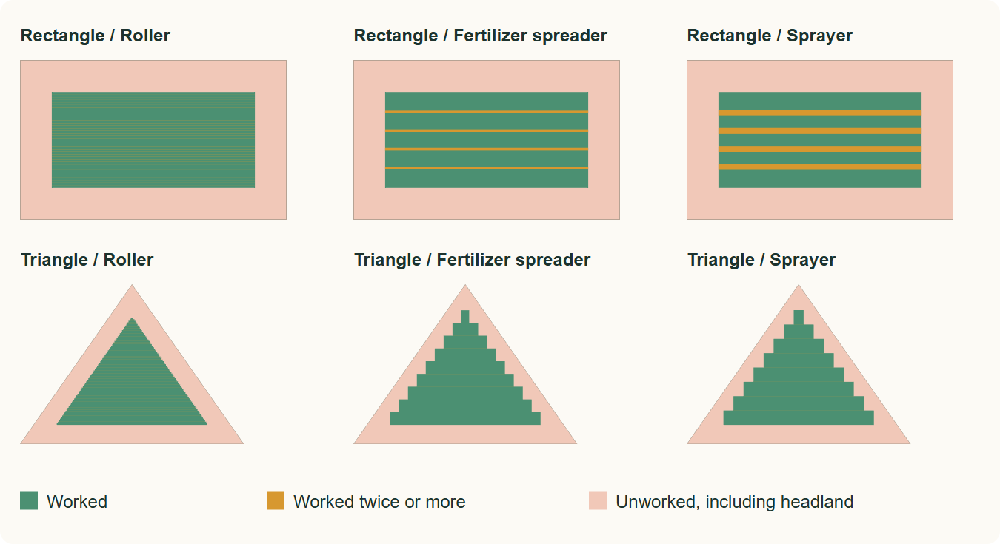

# How much of the field did the implement cover?

A tractor can leave tracks all the way around a headland with the spreader switched off. To test whether the cab display accounted for that, I drew two fields, a rectangle and a triangle, and ran three jobs on each. In every run, I recorded the tractor's path and the working width swept by the implement while it was engaged.

## Six runs on two field shapes

The first six runs have no operator-recorded work along the edges. The target for the automatic passes starts **36 m inside** the field boundary. For the **whole-field** coverage total, the simulator counts ground up to **0.5 m inside** that boundary. Travel with the implement off includes the distance the tractor covers without doing work. Overlap counts the area worked at least twice during the same job.

| Field | Implement and width | Automatic work time (min) | Travel with implement off (m) | Worked area (m²) | Unworked incl. edges (m²) | Overlap (m²) |
| --- | --- | ---: | ---: | ---: | ---: | ---: |
| Rectangle | Roller · 3.05 m | 133.14 | 1,682.90 | 24,678.00 | 28,843.00 | 1,108.23 |
| Rectangle | Spreader · 24 m | 17.23 | 217.85 | 24,678.00 | 28,843.00 | 2,742.00 |
| Rectangle | Sprayer · 27 m | 17.27 | 219.93 | 24,678.00 | 28,843.00 | 6,169.50 |
| Triangle | Roller · 3.05 m | 192.66 | 3,990.45 | 28,892.65 | 33,532.47 | 1,305.11 |
| Triangle | Spreader · 24 m | 22.75 | 411.42 | 31,943.21 | 30,481.91 | 105.31 |
| Triangle | Sprayer · 27 m | 26.27 | 716.69 | 32,394.90 | 30,030.22 | 92.10 |

In all six runs, the uncovered area inside the interior target and the area worked outside the field each rounded to **0.00 m²**. The pink regions mark edges with no recorded work. For example, the sprayer finished its interior passes on the triangle in **26.27 minutes**, with **30,030.22 m²** still uncovered across the whole work area. The cab shows the operator that remaining work at the end of the route. [View the job summary](../images/job-summary.png)

## What changed after recording one edge pass?

I repeated the rectangle test with the 24 m spreader. This time I recorded one simulated pass with the spreader on along an edge, then planned the route for the remaining work. The field, implement and heading stayed the same.

| Measure | No edge pass recorded | One edge pass recorded |
| --- | ---: | ---: |
| Area fertilized more than once | 2,742.00 m² | 91.20 m² |
| Unworked area including edges | 28,843.00 m² | 19,820.20 m² |
| Automatic travel with spreader off | 217.85 m | 162.80 m |
| Automatic work time | 17.23 min | 16.28 min |

Accounting for the operator's pass reduced the area fertilized more than once by **2,650.80 m²** in this example. The automatic part of the job was about a minute shorter. Comparing total job time would also require timing the operator's pass. Estimating fertilizer savings would require a measured application rate.

[Back to Tractor Guidance Simulator](../README.md)
