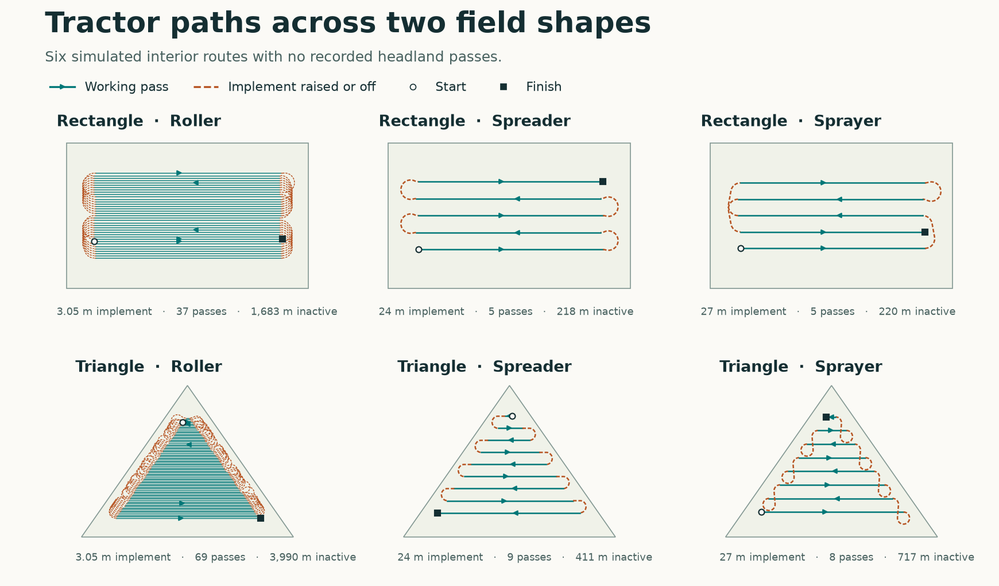

# Six routes through two synthetic fields

On the rectangle, the spreader and the sprayer each drove five passes. The spreader took the rows in order from bottom to top. The sprayer drove **1 → 3 → 5 → 4 → 2**, leaving two rows to fill on the return. Follow the open circle at the start of each route to see where the turns took the tractor.

## What the tractor traveled

I replayed each route to completion at the same heading. Each working pass counts once, regardless of length. Total travel follows the tractor through the passes and the connections between them. Inactive travel includes the turns and any distance covered while lifting or lowering the roller. The pass count comes from the route segments. I checked the length of their centerlines against the distance accumulated during replay.

| Synthetic field | Implement | Working passes | Total travel | Inactive travel | Share traveled inactive | Simulated time |
| --- | --- | ---: | ---: | ---: | ---: | ---: |
| Rectangle | 3.05 m roller | 37 | 10,137.40 m | 1,682.90 m | 16.6% | 133.14 min |
| Rectangle | 24 m spreader | 5 | 1,360.35 m | 217.85 m | 16.0% | 17.23 min |
| Rectangle | 27 m sprayer | 5 | 1,362.43 m | 219.93 m | 16.1% | 17.27 min |
| Triangle | 3.05 m roller | 69 | 13,891.35 m | 3,990.45 m | 28.7% | 192.66 min |
| Triangle | 24 m spreader | 9 | 1,746.78 m | 411.42 m | 23.6% | 22.75 min |
| Triangle | 27 m sprayer | 8 | 1,919.91 m | 716.69 m | 37.3% | 26.27 min |

## Why one fewer pass took more time

On the triangle, the spreader started near the tip and worked toward the base. The wider sprayer took the opposite direction and finished in eight passes. Its looping connections added up to **305.27 m more inactive travel** than the spreader's, even with one fewer pass. The spraying replay took **3.52 minutes longer**. These are two different implement jobs on the same shape. The comparison shows why I track travel between passes alongside pass count.

The maps show the tractor centerline. To see where the full working width landed and where ground remained unworked, use the coverage study. The times above cover the automatic interior passes and their connections. Edge work by the operator would add to the total. [See the worked area, overlap and remaining ground](field-coverage.md)

[Watch the triangle spraying replay](../images/spraying-route.gif) · [Back to the project](../README.md)
