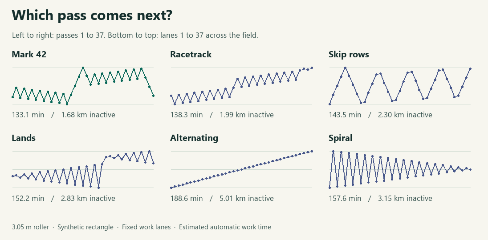

# How much can row order change the job?

For this test I kept the same 37 roller lanes used in the [route gallery](route-gallery.md). Each plan worked every lane once. The tractor could turn forward with the roller raised. The experiment asks how far the tractor has to travel between those otherwise identical passes.

Read each trace from left to right. A dot near the bottom is a pass near the lower edge of the field. A dot higher up is a pass farther across it. A straight diagonal in the alternating pattern means that the tractor visits the next adjacent lane every time. To see the turns on the ground, open the [route maps](route-gallery.md).

| Lane order | Estimated automatic work time | Travel with roller inactive |
| --- | ---: | ---: |
| Mark 42 | 133.14 min | 1,682.90 m |
| Courseplay racetrack | 138.33 min | 1,994.71 m |
| Courseplay skip rows | 143.46 min | 2,302.53 m |
| Courseplay lands (blocks) | 152.18 min | 2,825.35 m |
| Courseplay spiral | 157.64 min | 3,153.16 m |
| Courseplay alternating | 188.61 min | 5,011.29 m |

**Mark 42 finished about 5 minutes 12 seconds sooner than the fastest Courseplay pattern tested here.** It saved 312 m of inactive travel over the racetrack sequence. Moving directly to the neighboring lane gave the longest route in this test. The lane spacing was much narrower than the tractor's forward turning radius, so a small lateral move could require a long loop.

### How I kept the comparison fair

The benchmark used a synthetic 300 × 180 m rectangle, a 3.05 m roller, one working direction and a 12 m turning radius. The Courseplay FS25 generator supplied the alternative pass sequences. The same Mark 42 model connected and checked the turns and timed the work for all six, including lift and lower transitions. For each Courseplay family the table shows the fastest feasible entry and setting among those tested on the common lanes. The operator's time on the outer headland is outside these estimates. [Upstream Courseplay generator revision](https://github.com/Courseplay/Courseplay_FS25/tree/5cdd86f1c5bae0ded4af3845f067cd1535f9bbb8/scripts/courseGenerator)

All six left **0.00 m²** open inside the target and rolled **1,105.80 m²** of that interior at least twice. Keeping the strips fixed also kept their overlap fixed. The difference here comes from the connections between them. Different headings, field shapes or reverse turns could change the ranking.

[Back to Tractor Guidance Simulator](../README.md)
