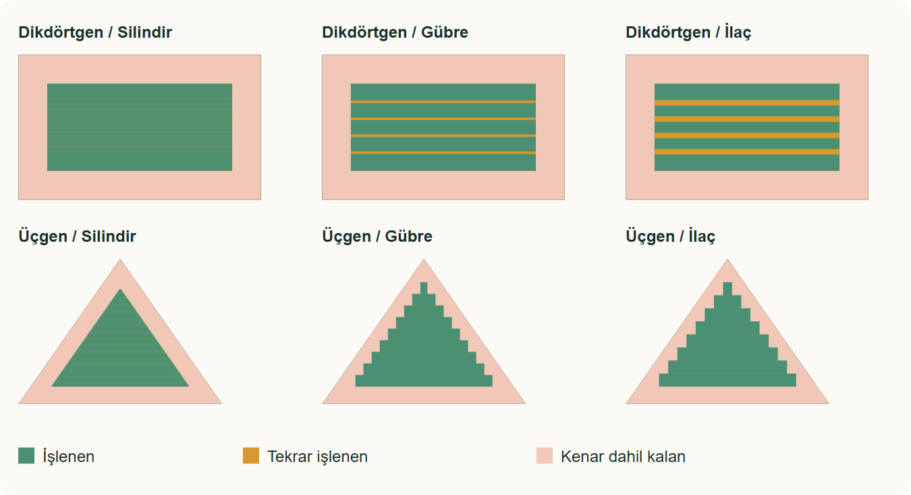

# Tarlanın ne kadarı işlendi?

Bir sürücü kenara kadar gidip döndüğünde traktörün izi yerde görünür. Ama makine dönüş boyunca kapalıysa o iz boyunca gübre atılmamıştır. Kabindeki kapsama hesabını sınamak için bir dikdörtgen ve bir üçgen çizdim. Aynı iki tarlada üç ayrı iş yürüttüm. Her işte traktörün hareketiyle aletin işlediği şeridi ayrı kaydettim.

## Altı koşunun sonucu

İlk altı denemede sürücünün kenar çalışmasına ait bir kayıt yok. Otomatik hatların hedefi tarla kenarından 36 metre içeride başlıyor. **Kenarla birlikte açık alan** hesabı ise sınırın yarım metre içine kadar uzanıyor. Tabloda boş gidiş, traktörün alet iş yapmadan aldığı yoldur. Bindirme, aynı işte en az iki kez işlenen yerlerin toplam yüzölçümüdür.

| Yapay tarla | Alet ve iş genişliği | Otomatik süre (dk) | Boş gidiş (m) | İşlenen alan (m²) | Kenarla birlikte açık alan (m²) | Bindirme (m²) |
| --- | --- | ---: | ---: | ---: | ---: | ---: |
| Dikdörtgen | Silindir · 3,05 m | 133,14 | 1.682,90 | 24.678,00 | 28.843,00 | 1.108,23 |
| Dikdörtgen | Gübre · 24 m | 17,23 | 217,85 | 24.678,00 | 28.843,00 | 2.742,00 |
| Dikdörtgen | İlaç · 27 m | 17,27 | 219,93 | 24.678,00 | 28.843,00 | 6.169,50 |
| Üçgen | Silindir · 3,05 m | 192,66 | 3.990,45 | 28.892,65 | 33.532,47 | 1.305,11 |
| Üçgen | Gübre · 24 m | 22,75 | 411,42 | 31.943,21 | 30.481,91 | 105,31 |
| Üçgen | İlaç · 27 m | 26,27 | 716,69 | 32.394,90 | 30.030,22 | 92,10 |

Altı koşuda da iç hedefteki boşluk ve parsel dışına taşan alan, iki ondalıkla **0,00 m²** çıktı. Haritada pembe kalan yerler, kenarlarda henüz iş kaydı olmayan bölgelerdir. Örneğin üçgende ilaçlama hatları 26,27 dakikada bittiğinde kabin hâlâ **30,03 dönüm** açık alan gösteriyordu. Bu sayede sürücü dış şeritlerde kalan işi görebiliyor. [Bu koşunun kabin sonuç kartı](../gorseller/is-sonucu.png)

## Sürücünün bir kenar geçişi neyi değiştirdi?

Dikdörtgende 24 metrelik gübre makinesiyle deneyi tekrarladım. Bu kez sürücünün tek bir kenarda gübre attığı geçişi simülasyona kaydedip kalan alan için rota oluşturdum. Alet, tarla ve sürüş yönü aynı kaldı.

| Ölçü | Kenar kaydı yok | Bir kenar geçişi kayıtlı |
| --- | ---: | ---: |
| Tekrar gübrelenen alan | 2.742,00 m² | 91,20 m² |
| Kenarla birlikte açık alan | 28.843,00 m² | 19.820,20 m² |
| Otomatik rotada boş gidiş | 217,85 m | 162,80 m |
| Otomatik rotanın süresi | 17,23 dk | 16,28 dk |

Bu örnekte sürücünün kenarda nereden geçtiğini bilen rota, **2.650,80 m² daha az yeri ikinci kez gübreledi**. Otomatik bölüm yaklaşık bir dakika kısaldı. Sürücünün kenarda geçirdiği süre bu hesaba dahil olmadığı için tam iş günündeki zaman kazancı ayrıca ölçülmeli. Gübre tüketimi için de alana ek olarak gerçek atım miktarını ölçmek gerekiyor.

[Projenin ana sayfasına dön](../README.md)
